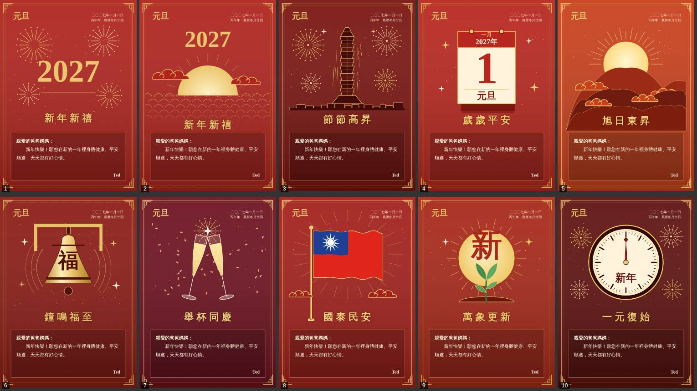

# 年節賀卡坊

給家中長輩的傳統喜氣賀卡產生器。單一 HTML 檔，不需要安裝或建置，用瀏覽器打開 `index.html` 就能使用。

**正式網址：<https://greeting-card-generator.hoya-chen.workers.dev/>**

請用這個網址打開、裝到手機、分享給家人。網站放在 Cloudflare Workers（見下方「部署」），也可以裝成手機 App（PWA）。Claude 的 artifact 連結只是預覽版，從那裡安裝不會有「賀卡坊」圖示，頁面頂端也會提示改用正式網址。

## 裝到手機

- **iPhone**：用 Safari 打開網址，按下方「分享」鈕，選「加入主畫面」。
- **Android**：用 Chrome 打開網址，按頁面上的「安裝到手機桌面」，或在選單選「安裝應用程式」。
- 裝好後桌面會出現紅底金字的「賀卡坊」圖示，全螢幕開啟；打開過一次之後，沒有網路也能做賀卡（字型也會存下來）。
- 在手機上按「儲存／分享賀卡」會叫出分享選單，可以直接「儲存影像」到相簿，或傳到 LINE。

## 分享到 LINE／微信

賀卡下方有「傳到 LINE」「傳到微信」兩個按鈕：

- **手機瀏覽器或已安裝的 App**：叫出手機的分享選單，帶著賀卡圖片，點 LINE 或微信再選好友。
- **在微信裡打開網頁**：跳出整張圖，長按圖片選「發送給朋友」。
- **在 LINE 裡打開網頁、或手機不支援分享圖片**：跳出整張圖讓你長按儲存再傳，LINE 另外附「用 LINE 傳祝賀文字」按鈕。
- **電腦**：跳出整張圖，存下來後拖進 LINE／微信電腦版的聊天室。

微信不開放一般網站直接分享，所以有些情況需要先存圖再傳。分享按鈕只在網站上出現，Claude 的 artifact 版本不顯示。

## 功能

- **先選「中國節日」或「西洋節日」**，下面只列出那一類的節日，畫面不擠：
  - 中國節日（6 個）：春節、元宵、端午、中秋、重陽、冬至。
  - 西洋節日（8 個）：元旦、情人節、復活節、母親節、父親節、萬聖節、感恩節、聖誕節。
- **圖案風格四選一：卡通／風景／花草／傳統**（手機會記住上次選的風格），用「換一張」在同一種風格裡切換：
  - 卡通：每個節日 5 張，圓滾滾、會笑的可愛圖案。
  - 風景：每個節日 10 張自然風景照（山水、花草、明月、雪景、日出等）。
  - 花草：15 張花草照（牡丹、蓮花、蘭花、菊花、櫻花、向日葵、玫瑰等），每個節日都能用，配上該節日的祝福字。
  - 傳統：紅金色調、依節日習俗畫的圖案（原本的節日 10 張，新加的四個西洋節日各 5 張）。
- **風景照與花草照**：全部是 CC0（公眾領域）照片，可自由使用、商用。照片放在 `bg/` 資料夾，每張約 70 KB，換到那張時才下載；裝成 App 後看過的照片會存下來，沒網路也能用。照片上下有暗幕，吉祥話、日期與祝福文字在下載的 PNG 上也清楚。
- **選西元年就自動帶日期**：支援 2026–2036 年。賀卡右上角會自動填入中文數字的國曆日期、干支年和農曆日期，例如「二〇三〇年二月三日／庚戌年 農曆正月初一」。
- **生肖跟著年份換**：春節的吉祥話與生肖圓章會依年份改變，例如 2030 狗年是「旺年納福」。
- **稱呼與署名**：可以選「爸爸媽媽」「爺爺奶奶」「各位同學」等稱呼，也可以自己輸入；署名也是下拉選單（預設 Ted），選「自己輸入…」可以打字。
- **長輩不用打字**：拿長輩的手機打開網站（或桌面上的賀卡坊），展開「設定選單」，填好署名清單和要另外加的稱呼，按「儲存選單」。這支手機以後就只要用點的選，上次選的名字也會記住。清單存在那支手機的瀏覽器裡，換手機或清除瀏覽資料要重新設定；iPhone 桌面上的 App 和 Safari 分開記，請在桌面 App 裡設定。
- **吉祥話**：每個節日 20 句（含應景的詩詞與成語），可「換一句」或「複製祝賀文字」貼到 LINE。
- **下載圖片**：「下載賀卡圖片」會存成 1000×1400 的 PNG，和畫面上的預覽完全一樣。在無法直接下載的環境（例如只有分享連結的檢視者），按鈕會變成「看圖並儲存」，跳出整張圖讓人長按或按右鍵儲存。

## 樣板預覽

| | | |
|---|---|---|
|  |  |  |
|  |  |  |
|  |  |  |
|  | | |

風景照樣板（每個節日 10 張，這裡各挑一張）：

## 日期資料

- 春節、元宵、端午、中秋、重陽的國曆日期已對照公開的歷年日期表。2027 年春節是 2/6、2030 年是 2/3，這兩年瀏覽器內建農曆會差一天，所以以日期表為準。
- 冬至依天文時刻換算成台灣時間（12/21 或 12/22）。
- 聖誕、元旦、母親節、父親節的農曆日期由農曆換算而來，極少數情況可能差一天。
- 元旦在春節之前，干支年算前一年。

日期表寫在 `src/core.js` 的 `TABLE` 常數裡；要延伸年份，就在表裡加一年的資料。

## 檔案與建置

`index.html` 是由 `src/` 組合出來的單一檔案，改完原始碼後執行 `python3 tools/build.py` 重新產生。

- `src/head.html`、`src/core.js`、`src/app.js`：頁面、日期表與共用繪圖函式、介面與合成。
- `src/legacy.js`：每個節日最早的兩張樣板。
- `src/cartoon.js`：卡通圖的畫圖工具（笑臉、愛心、南瓜、兔子……）；`src/cartoons.js`：每個節日的 5 張卡通圖。
- `src/festivals/<節日>.js`：每個節日各一個檔案，裡面有傳統樣板的繪圖程式與 20 句吉祥話。要新增樣板或祝賀詞，只要改這個檔案。
- `tools/preview.js`：預覽單一節日的全部樣板（需要 Playwright），並檢查樣板數、祝賀詞數與長度。
- `bg/<節日>/01.webp`～`10.webp`：風景照樣板的照片（912×956）。來源、作者與授權列在 `bg/CREDITS.md`；要換照片，改 `bg/sources.json` 後執行 `python3 tools/fetch_bg.py`（刪掉舊檔或加 `--force` 才會重抓），再調整節日檔最後的 `photoSet(...)` 說明與吉祥話。
- `bg/flowers/01.webp`～`15.webp`：花草樣板的照片，所有節日共用；說明與吉祥話在 `src/flowers.js`。
- `fonts/tw-kai.woff2`：全字庫正楷體（常用 5400 字），電腦沒有標楷體時用它；再沒有的字改用霞鶩文楷。來源與授權（政府資料開放授權條款第 1 版）列在 `fonts/CREDITS.md`。
- 因為照片是另外的檔案，直接用瀏覽器打開本機的 `index.html`（file://）時，風景照樣板無法下載成圖片；請用網站，或在資料夾裡執行 `python3 -m http.server` 再開 `http://localhost:8000`。
- `docs/`：樣板預覽圖。
- `manifest.webmanifest`、`sw.js`、`icons/`：App 安裝設定、離線快取與圖示。改了 `index.html` 之後，把 `sw.js` 裡的 `VERSION` 加一，已安裝的手機才會更新。圖示由 `tools/icons.js` 產生（需要 Playwright）。

## 部署（Cloudflare Workers）

網站是 Cloudflare Worker，已連到這個 repo 的 `main` 分支，網址是 <https://greeting-card-generator.hoya-chen.workers.dev/>。純靜態網頁，不需要建置；每次合併到 `main` 都會自動更新網站。

要重新設定時：Cloudflare 後台 → Workers & Pages → Create → 匯入 Git repo，選這個 repo、分支 `main`，Build command 留空，輸出目錄 `/`。
